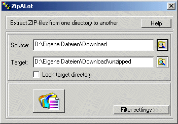
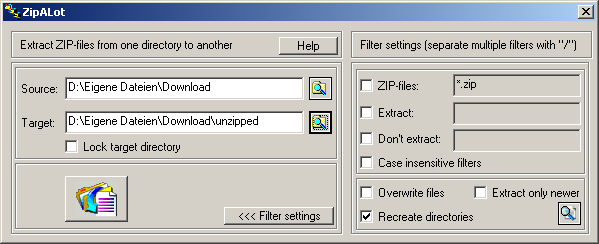
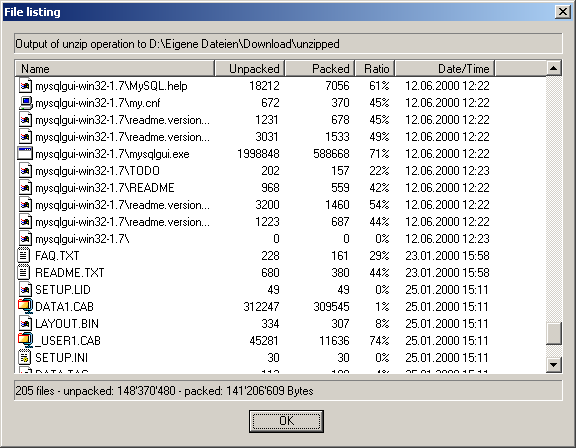
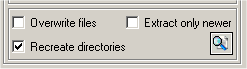

# ZipALot

A Windows batch extractor for ZIP, RAR and ACE archives, written in C++ with
MFC between December 1999 and May 2002. Version 3.22 (3 April 2002) was the
last release; it was published as freeware under the GPL at
`http://www.ractive.ch/gpl/zipalot.html`.

## What's that?

From the original `ReadMe.txt`:

> Most of the unpack programs only can handle one archive at once.
>
> ZipALot takes all the archives from one directory and extracts them to another one.
>
> ZipALot can currently handle ZIP, RAR and ACE (V.2) archives.
>
> Filter options allow you to control the extraction process.
> Tell which archives you want to extract, which files you want to have extracted from
> the archives and which not.
> With a simple click you extract i.e. all your images from dozens of archives!
>
> Advanced rules give you even more powerful options...
> You can enter multiple filter rules in the "Extract" and "Don't extract" fields.
> Separate them with a slash ("/").
>
> An example how to use these filter rules:
>
>     Archives:      images*.zip//
>     Extract:        *.jpg/*.jpeg/*.gif
>     Don't extract:  old*/tmp*
>
> All ZIP-files that begin with "images" are processed (i.e. images1.zip, images2.zip,
> imagesNew.zip...). All files with the extension jpg, jpeg and gif are extracted but
> those beginning with "old" or "tmp".

## Features

- Extracts every archive of a source directory into a target directory in one
  go. Supported formats: ZIP (Info-ZIP `unzip32.dll`), RAR (`unrar.dll`), ACE 2
  (`unacev2.dll`); a bzip2 stub exists but was never finished.
- Simple filter page: choose which archive types to process and which file
  classes to extract (images, documents, web documents, music, video,
  programs).
- Expert filter page: wildcard rules for archives, "extract" and "don't
  extract", separated by `/`, with one rule each for ZIP, RAR and ACE;
  case-insensitive matching; overwrite, extract-only-newer, recreate the
  archive's directory structure, own subdirectory per archive.
- "Unzip File List" preview: shows the archives found and the files that would
  be extracted before anything is written.
- Progress dialog with animation, file tree of extracted files, "close when
  done".
- Password prompt for encrypted archives.
- Lockable target directory, "use temp directory", source and target pickers,
  "show in Explorer" buttons, drag a folder onto the window to make it the
  source, Explorer context-menu entry "Extract archives with ZipALot"
  (`zipalot.inf`).
- NFO viewer for `.nfo` files (`NfoViewer.cpp`), tip-of-the-day dialog,
  configuration dialog (startup directories, default installation directory,
  target subdirectory suffix, always on top).
- "Warez Wizard": a step-by-step mode that unpacks a download directory,
  detects self-extracting `.exe` archives and nested archives, lists `.nfo`
  files to read, proposes follow-up actions (run the setup, run `.reg` files,
  extract a single archive into the installation directory) and offers to delete
  the temporary files at the end.
- Settings are persisted in the registry via `CRegBinding`.
- NSIS installer script (`zipalot.nsi`), WinHelp project (`hlp/`, `help-src/`).

**Historical note.** The "Warez Wizard" naming in the code, resources and
readme is kept untouched; the wording reflects the Windows freeware scene of
2002. Technically the wizard is a batch-unpack feature that auto-detects
self-extracting archives and nested archives and suggests what to run next.

## Screenshots

From the WinHelp project (December 2000, version 3.0 user interface).

| | |
|---|---|
|  |  |
|  | |

## Building

- Microsoft Visual C++ 6.0 with MFC. Open `ZipALot.dsw` and build the
  `ZipALot` project. The help file is built with Microsoft Help Workshop via
  `MakeHelp.bat`, the installer with NSIS from `zipalot.nsi`.
- At run time the program loads three DLLs dynamically (`LoadLibrary` in
  `Unzip.cpp`, `Unrar.cpp`, `Unace.cpp`). They are **not included** here:
  - `unzip32.dll` from Info-ZIP (UnZip 5.4 DLL build).
  - `unrar.dll` from RARLAB.
  - `unacev2.dll` from ACE Compression Software.

  They were left out for two reasons. First, each has its own redistribution
  licence (the ACE header explicitly states that use of the DLL in other
  programs is subject to contract). Second, `unacev2.dll` has a well-known
  directory-traversal vulnerability, CVE-2018-20250, disclosed in 2019: a
  crafted ACE archive can write files outside the target directory. The DLL has
  not been maintained since 2007 and WinRAR dropped it for that reason. Do not
  use ZipALot with ACE archives from untrusted sources. The header files
  describing the DLL interfaces (`UNRAR_.H`, `UNACE_.H` and companions,
  `structs.h`, `unzver.h`) are included with their original notices.

## Repository layout

| Path | Content |
|---|---|
| `*.cpp`, `*.h`, `ZipALot.rc`, `res/` | The MFC dialog application. |
| `hlp/` | WinHelp project generated by AppWizard (`ZipALot.hpj`, `AfxDlg.rtf`, `.cnt`, `.hm`). |
| `help-src/` | "Windows Help Designer" project of the user help (images, `.hpj`, `.CNT`, `.hm`; the topic text was in a password-protected `ZipALot.CRTF` container written by that tool, which is not included). |
| `zipalot.nsi`, `zipalot.inf` | NSIS installer script and the Explorer context-menu registration. |
| `docs/screenshots/` | PNG conversions of the help images. |

## History

| Commit | Content |
|---|---|
| 1 | The working copy of 4 August 2001 from a backup of the author's machine: version 3.21 (25 May 2001), six files differ from 3.22. |
| 2 | `ZipALot_src.zip` as published with release 3.22 (3 April 2002). |
| 3 | The working copy with the last edits (8 May 2002): extraction error handling in `Extract.cpp`, `Unace.cpp`, `Unrar.cpp`, `Unzip.cpp`, `WhatIfDlg.cpp`, `WizPageAction.cpp`, updated ACE headers. |
| 4 | The WinHelp project of the user help from the "Windows Help Designer" (December 2000 / January 2001). |
| 5 | This README, licence files and screenshots. |

Earlier versions (1.x, 2.x, 3.0 to 3.2, 1999 to mid-2001) are not preserved.

### History of this repository

ZipALot was never kept under version control, so the history consists of
snapshots committed in chronological order with the newest source file's
modification time as author date. The root commit is the author's working copy
of 4 August 2001 recovered from a machine backup of 2001 (version string 3.21 in
`ZipALot.rc`, `ReadMe.txt` still saying 3.2); it differs from the 3.22 release
in only six files. The 3.22 release zip and the May 2002 working copy follow,
then the help project, then the archive documentation.

## Notes on this archive

- Excluded: the compiled installer `ZipALot.exe`, compiled `.HLP`/`.GID` help
  files, Visual C++ IDE state files, `.old` backups of the ACE headers, and the
  duplicate help project folder. No unpacker DLLs were present in the sources.
- Scrubbed: the author's street address in the help source `hlp/AfxDlg.rtf`.
  The remaining personal data are the author's own `ractive.ch` addresses. The code contains hard-coded `C:\TEMP` and `C:\`
  fallbacks.
- Source files are Windows-1252 encoded with CRLF line endings and are stored
  byte-for-byte (`.gitattributes` disables text conversion).
- Author: Jean-Pierre Bergamin <james@ractive.ch>.

## Licence

GNU General Public License, version 2 (see `LICENSE` and the original
`LICENSE.TXT`). Third-party headers and classes keep their own licences; see
`THIRD_PARTY.md`.

## Where it was published

- The ractive.ch project page (archived):
  <http://web.archive.org/web/20021001170620/http://www.ractive.ch/gpl/zipalot.html>.
  Versions listed there: 2.1 (March 2001), 3.0 (mid 2001), 3.22.
- Softpedia, "ZipALot 3.22" (GPL, 249 KB), 5,423 downloads by 2012:
  <https://www.softpedia.com/get/Compression-tools/ZipALot.shtml>.
- Brothersoft, 2,566 downloads by 2013 (archived):
  <http://web.archive.org/web/20130711123140/http://www.brothersoft.com/zipalot-71322.html>.
- Also listed on downloadsource.net (<https://www.downloadsource.net/8413/zipalot/>)
  and Softonic (<https://zipalot.en.softonic.com/>).
- Original screenshots from the ractive.ch page are in
  `docs/screenshots/ractive.ch/`.
